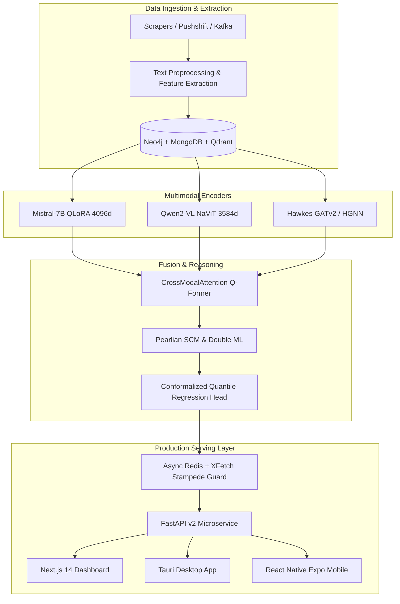

# PRSI (Doom Index) Documentation

Welcome to the technical documentation for **PRSI (Predictive Real-time Social Intelligence)**, formerly known as the **Doom Index**. PRSI is a frontier multimodal artificial intelligence and temporal graph platform designed to detect, forecast, and de-escalate high-velocity social media outrage cascades and collective cancellation risks.

---

## 📚 Documentation Index

### 1. System Architecture
- [**01. End-to-End System Architecture**](file:///Users/ajay/Downloads/doom-index/docs/architecture/01_system_architecture.md): Microservices topology, Kong API Gateway, FastAPI v2, Triton Inference Server, and cross-platform clients (Web, Desktop, Mobile).
- [**02. Streaming & Data Pipelines**](file:///Users/ajay/Downloads/doom-index/docs/architecture/02_data_streaming_pipeline.md): Real-time Kafka ingestion, Apache Flink CEP cascade detection, Redis cache with XFetch stampede protection, Neo4j temporal graph, and MongoDB storage.
- [**03. Multimodal Fusion Engine**](file:///Users/ajay/Downloads/doom-index/docs/architecture/03_multimodal_fusion.md): Trilateral fusion of Mistral-7B text, Qwen2-VL vision, and Hawkes GATv2 network topology via learned Q-Former attention and InfoNCE contrastive pretraining.

### 2. Models & Scientific Subsystems
- [**SOTA Frontier Subsystems**](file:///Users/ajay/Downloads/doom-index/docs/models/sota_subsystems.md): Mathematical derivations and architectures for the 11 verified subsystems (CQR, Diffusion Forecaster, HGNN, Pearlian DML, DuckDB OLAP, etc.).
- [**Adversarial Hardening & Red Teaming**](file:///Users/ajay/Downloads/doom-index/docs/models/adversarial_and_red_team.md): GCG coordinate gradient optimization, AutoDAN genetic prompt mutations, Unicode steganography (ZWS), and homoglyph defense.
- [**Privacy & Federated Learning**](file:///Users/ajay/Downloads/doom-index/docs/models/privacy_and_federated_learning.md): Layer-wise Adaptive DP-Adam ($(\varepsilon, \delta)$-DP) and TenSEAL CKKS Homomorphic Encryption with Secure Multi-Party Computation (SMPC).
- [**Production Model Card**](file:///Users/ajay/Downloads/doom-index/docs/models/model_card.md): Full dataset provenance, evaluation metrics, intended use, limitations, and benchmark results.

### 3. API & Developer Interfaces
- [**FastAPI v2 Reference**](file:///Users/ajay/Downloads/doom-index/docs/api/api_reference.md): Endpoint specifications for `/analyze`, `/analyze/explain`, `/attack`, `/dashboard/leaderboard`, authentication, and request schemas.
- [**Live Streaming & SSE**](file:///Users/ajay/Downloads/doom-index/docs/api/streaming_and_sse.md): Server-Sent Events (`GET /events`), real-time threat ticker, event payloads, and frontend client integration.

### 4. Developer & Operator Guides
- [**Getting Started & Local Setup**](file:///Users/ajay/Downloads/doom-index/docs/guides/getting_started.md): Installation, environment variables, local CPU fallbacks (`HPC_MODE=0`), and dependency resolution.
- [**HPC Orchestration & 27B Scaling**](file:///Users/ajay/Downloads/doom-index/docs/guides/hpc_and_scaling_27b.md): Slurm cluster deployment, DeepSpeed ZeRO-3, Triton Inference Server configuration, and scaling to 27B models (Gemma-2, Qwen-27B).
- [**Testing, Verification & Benchmarking**](file:///Users/ajay/Downloads/doom-index/docs/guides/testing_and_benchmarking.md): How to execute the 11/11 SOTA verification suite, unit tests, and avoid `typeguard` compilation overhead.

### 5. Compliance & Ethics
- [**EU AI Act Annex IV Dossier**](file:///Users/ajay/Downloads/doom-index/docs/compliance/eu_ai_act_annex_iv.md): Technical documentation for high-risk AI systems, risk mitigation logs, data governance, and red team security audit reports.

---

## ⚡ Quick System Overview

