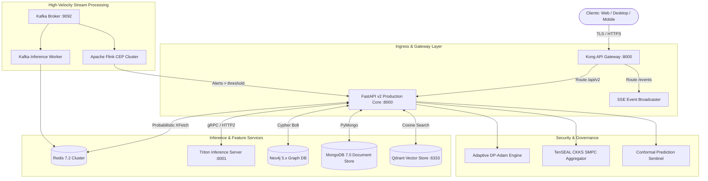
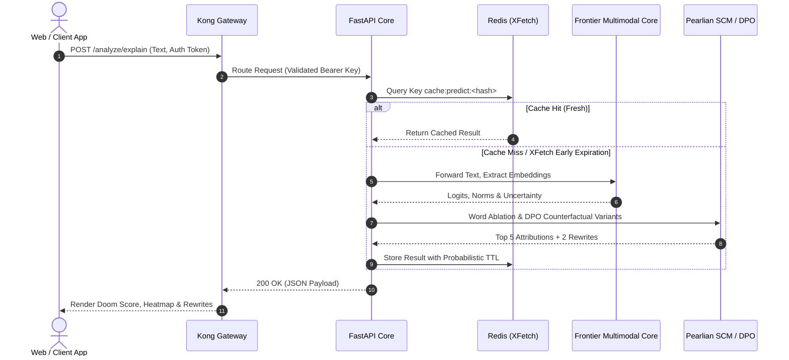

# System Architecture

## Overview
**PRSI (Predictive Real-time Social Intelligence)** is an enterprise-grade AI system architected for sub-second social media risk analysis, outrage cascade prediction, and de-escalation recommendation. The platform is designed around a decoupled, microservice-based architecture capable of running in lightweight local developer mode or distributed high-performance computing (HPC) clusters.

---

## 🏗️ Architectural Topology

---

## 🧩 Microservice Components

### 1. Kong API Gateway
- **Config**: Defined in [`apps/api-gateway/kong.yaml`](file:///Users/ajay/Downloads/doom-index/apps/api-gateway/kong.yaml).
- **Responsibilities**:
  - Central ingress point with TLS termination.
  - JWT / API Key verification (`Authorization: Bearer <token>`).
  - Strict rate limiting: 100 requests/minute for standard tiers, 1000 requests/minute for enterprise.
  - Path preservation (`strip_path: false`).

### 2. FastAPI Production Core
- **Source**: [`apps/backend/src/api/api_v2_production.py`](file:///Users/ajay/Downloads/doom-index/apps/backend/src/api/api_v2_production.py).
- **Key Capabilities**:
  - `/analyze`: Low-latency doom score inference.
  - `/analyze/explain`: In-depth token-level VADER attribution heatmap, emoji emotional swing extraction, and Pearlian DPO counterfactual rewrites.
  - `/attack`: Adversarial token mutation generation via GCG and AutoDAN.
  - `/events`: Real-time Server-Sent Events stream scoring social media posts dynamically.
  - Hardened CORS middleware supporting local development (`http://localhost:3000`, `http://localhost:3001`, `http://localhost:8080`).

### 3. Triton Inference Server
- **Client**: [`apps/backend/src/api/triton_client.py`](file:///Users/ajay/Downloads/doom-index/apps/backend/src/api/triton_client.py).
- **Role**: Dispatches batch model inferences for Mistral-7B and Qwen2-VL to NVIDIA TensorRT-LLM runtimes.
- **Local Fallback**: Automatically degrades to CPU-based sinusoidal projection when running locally (`HPC_MODE=0` or unreachable Triton endpoint), ensuring seamless developer workflows without CUDA hardware.

### 4. Storage & State Engines
- **Neo4j Temporal Graph**: Models user-to-user retweets, replies, mentions, and cascade topologies with dynamic edge timestamps.
- **MongoDB**: Stores raw crawled social records, metadata, author follower distributions, and cancellation event records.
- **Qdrant**: Manages 4096-dimensional Mistral-7B semantic embeddings for fast nearest-neighbor counterfactual retrieval.
- **Redis Cluster**: Caches predictions using the **XFetch probabilistic early recomputation algorithm**, preventing cache stampedes under flash traffic.

---

## 🔄 Request Lifecycle: `/analyze/explain`

