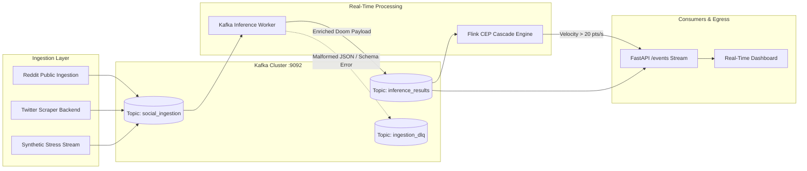

# Streaming & Data Pipelines

## Overview
PRSI processes real-time event streams from multiple platforms (Twitter/X, Reddit, Instagram) to detect viral outrage outbreaks before they reach critical mass. The streaming architecture integrates **Apache Kafka**, **Apache Flink Complex Event Processing (CEP)**, and **Redis with XFetch probabilistic cache protection**.

---

## 🌊 Pipeline Architecture



---

## 📦 Kafka Message Specifications

### 1. Ingestion Topic (`social_ingestion`)
Messages posted by crawlers and webhook connectors adhere to the following schema:

```json
{
  "message_id": "msg_98a72f0b-4b11-42ec-a05d-e0bb2a792df9",
  "source": "reddit",
  "subreddit": "technology",
  "user_id": "author_4091",
  "text": "This company's leadership must resign immediately! Unacceptable fraud! 🤡💀",
  "timestamp": 1728771200000,
  "metrics": {
    "followers": 14200,
    "retweet_count": 85,
    "reply_count": 34
  }
}
```

### 2. Inference Results Topic (`inference_results`)
Emitted by [`kafka_inference_worker.py`](file:///Users/ajay/Downloads/doom-index/apps/backend/src/streaming/kafka_inference_worker.py):

```json
{
  "prediction_id": "pred_7c8d9e0f",
  "source_id": "author_4091",
  "source": "reddit",
  "text_snippet": "This company's leadership must resign immediately...",
  "doom_score": 87.4,
  "risk_level": "RISK_LEVEL_EXTREME",
  "emoji_metrics": {
    "emoji_count": 2,
    "outrage_score": 0.85,
    "panic_score": 0.40,
    "irony_flag": true
  },
  "timestamp": 1728771201500
}
```

---

## ⚡ Apache Flink Complex Event Processing (CEP)

Located in [`flink_cascade_cep.py`](file:///Users/ajay/Downloads/doom-index/apps/backend/src/streaming/flink_cascade_cep.py), the CEP engine detects rapid sentiment escalation across sliding time windows:

### Cascade Detection Logic
1. **Sliding Window:** Evaluates a 60-second window with 5-second slide increments.
2. **Velocity Metric:** $\Delta \text{Doom} / \Delta t$ across events referencing the same entity or hashtag cluster.
3. **Thresholds:**
   - **Velocity Trigger:** Velocity $> 20.0 \text{ pts/second}$.
   - **Density Trigger:** $> 15$ outrage events in under 30 seconds.
4. **Action:** Emits an immediate `OUTRAGE_CASCADE_SPIKE` alert to the FastAPI streaming channel and triggers automated DPO counterfactual generation.

---

## 🛡️ XFetch Probabilistic Cache Stampede Guard

Located in [`cache_async.py`](file:///Users/ajay/Downloads/doom-index/apps/backend/src/api/cache_async.py), this algorithm solves the dog-piling problem where thousands of concurrent requests recompute an expired cache key simultaneously.

### The Algorithm
When querying key $k$:
$$\Delta = -\beta \cdot \delta \cdot \ln(U)$$
where:
- $\delta$ is the compute time taken to generate the prediction (seconds).
- $\beta > 0$ is an aggression multiplier (default $\beta = 1.0$).
- $U \sim \text{Uniform}(0, 1)$ is a random draw.

If $\text{expiry} - \Delta \le \text{now}$, the reading client **early-recomputes** the key in the background while immediately returning the existing value to the caller. This statistically guarantees that exactly **one** client refreshes the cache before expiration, preventing load spikes.
