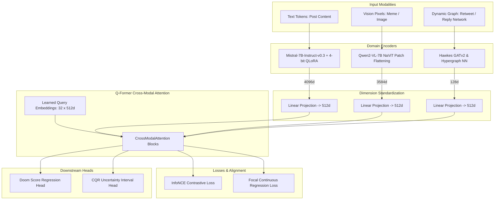

# Multimodal Fusion Engine

## Overview
Social outrage cannot be accurately modeled through text alone; it propagates through a toxic synergy of viral imagery (memes), network topologies (retweet cascades), and inflammatory copy. PRSI fuses these three modalities into a unified latent space using a **Querying Transformer (Q-Former)** architecture paired with **InfoNCE contrastive alignment**.

---

## 🔬 Trilateral Modality Topology

---

## 🧠 Encoder Details

### 1. Text Encoder (`Mistral-7B-Instruct-v0.3`)
- **Location**: [`apps/backend/src/models/gnn_model.py`](file:///Users/ajay/Downloads/doom-index/apps/backend/src/models/gnn_model.py).
- **Configuration**: 4-bit BitsAndBytes quantization (`nf4`), $r=16$, $\alpha=32$ LoRA adapters targeting `q_proj` and `v_proj`.
- **Causal Token Pooling**: Because Mistral is a causal decoder-only transformer, pooling does **not** take index 0. Instead, it extracts the exact last non-padded token:
  $$\text{seq\_lengths} = \sum_{j} \text{attention\_mask}_{i,j} - 1$$
  $$\mathbf{h}_{\text{text}} = \text{hidden\_states}[i, \text{seq\_lengths}, :]$$
- **Local Fallback**: 4096-dimensional embedding table (`nn.Embedding(32768, 4096)`) with masked mean-pooling when running on CPU or `HPC_MODE=0`.

### 2. Vision-Language Encoder (`Qwen2-VL-7B-Instruct`)
- **Location**: [`apps/backend/src/models/vision_encoder.py`](file:///Users/ajay/Downloads/doom-index/apps/backend/src/models/vision_encoder.py).
- **Patch Flattening**: Handles dynamic image aspect ratios using Native Vision Transformer (NaViT) patch grids:
  $$N_{\text{patches}} = \left(\frac{H}{14}\right) \times \left(\frac{W}{14}\right)$$
  Avoiding standard square cropping that destroys meme text punchlines.
- **OCR Integration**: Extracts embedded meme text directly in latent space, fusing visual features ($\mathbf{v} \in \mathbb{R}^{3584}$) with lexical embeddings.

### 3. Graph Reasoning (`Hawkes GATv2 & HGNN`)
- **Location**: [`apps/backend/src/models/gat_model.py`](file:///Users/ajay/Downloads/doom-index/apps/backend/src/models/gat_model.py), [`apps/backend/src/models/hypergraph_gnn.py`](file:///Users/ajay/Downloads/doom-index/apps/backend/src/models/hypergraph_gnn.py).
- **Topology**: Computes attention weights dynamically modulated by the time decay of mutual interactions (Hawkes process intensity).

---

## ⚡ Cross-Modal Attention Mechanism

The Q-Former utilizes $K = 32$ learned query tokens $\mathbf{Q} \in \mathbb{R}^{32 \times 512}$ that interact with the projected representations $\mathbf{X}_{\text{text}}$, $\mathbf{X}_{\text{vis}}$, and $\mathbf{X}_{\text{graph}}$ through alternating self-attention and cross-attention blocks:

$$\text{Attention}(\mathbf{Q}, \mathbf{K}_m, \mathbf{V}_m) = \text{softmax}\left(\frac{\mathbf{Q} \mathbf{W}_Q (\mathbf{K}_m \mathbf{W}_K)^T}{\sqrt{d_k}}\right) \mathbf{V}_m \mathbf{W}_V$$

where $m \in \{\text{text}, \text{vision}, \text{graph}\}$. This forces the query tokens to extract cross-modal signals (e.g. text that is innocuous alone but inflammatory when paired with a cynical meme template).
