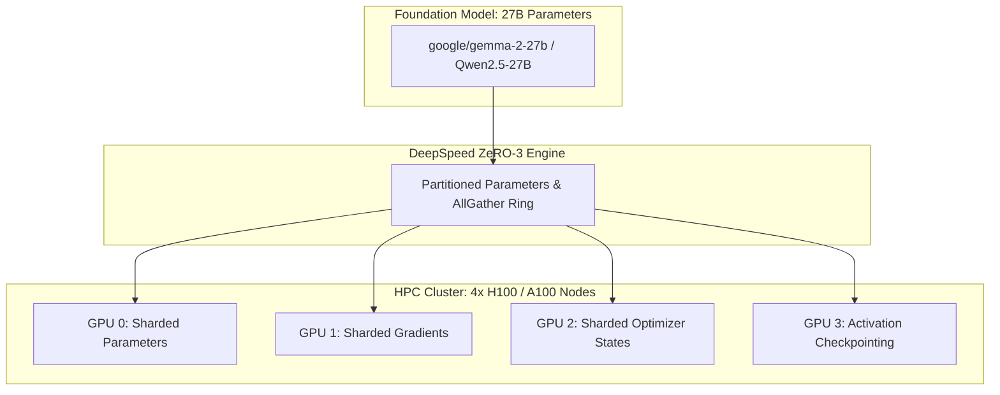

# HPC Cluster Deployment & 27B Model Scaling

## Overview
While PRSI operates seamlessly on developer laptops in local fallback mode (`HPC_MODE=0`), production training and cluster deployments utilize distributed GPUs on Slurm-managed HPC environments. This guide details how to scale from 7B foundation models to **27B models (Gemma-2-27B, Qwen2.5-27B)** using **DeepSpeed ZeRO-3** and **4-bit QLoRA**.

---

## 🚀 Scaling to 27B Parameters



### Memory Footprint Comparison

| Model | Parameters | Precision | Memory (FP16/BF16) | Memory (4-bit QLoRA) | Recommended Cluster |
| :--- | :--- | :--- | :--- | :--- | :--- |
| **Mistral-7B** | 7.2B | BF16 | ~14.5 GB | **~5.5 GB** | $1\times$ RTX 4090 / A100 |
| **Gemma-2-27B** | 27.2B | BF16 | ~54.0 GB | **~18.5 GB** | $1\times$ A100 (80GB) or $2\times$ A100 (40GB) |
| **Qwen2.5-27B** | 27.5B | BF16 | ~55.0 GB | **~19.0 GB** | $1\times$ A100 (80GB) or $2\times$ A100 (40GB) |

---

## 📜 DeepSpeed ZeRO-3 Configuration

Located in [`apps/backend/src/training/deepspeed_config.py`](file:///Users/ajay/Downloads/doom-index/apps/backend/src/training/deepspeed_config.py):

```json
{
  "train_batch_size": "auto",
  "train_micro_batch_size_per_gpu": 2,
  "gradient_accumulation_steps": 8,
  "bf16": {
    "enabled": true
  },
  "zero_optimization": {
    "stage": 3,
    "offload_optimizer": {
      "device": "cpu",
      "pin_memory": true
    },
    "offload_param": {
      "device": "cpu",
      "pin_memory": true
    },
    "overlap_comm": true,
    "contiguous_gradients": true,
    "sub_group_size": 1e9,
    "reduce_bucket_size": "auto",
    "stage3_prefetch_bucket_size": "auto",
    "stage3_param_persistence_threshold": "auto"
  }
}
```

---

## 🖥️ Slurm Job Submission Script (`train_27b.sh`)

```bash
#!/bin/bash
#SBATCH --job-name=prsi-27b-train
#SBATCH --nodes=1
#SBATCH --ntasks-per-node=4
#SBATCH --gres=gpu:4
#SBATCH --cpus-per-task=16
#SBATCH --mem=256G
#SBATCH --time=12:00:00
#SBATCH --output=logs/slurm-%j.out

module load cuda/12.3 nccl/2.19
source ~/.bashrc
conda activate prsi-env

export HPC_MODE=1
export NCCL_DEBUG=INFO
export MODEL_NAME="google/gemma-2-27b"

torchrun --nproc_per_node=4 \
    apps/backend/src/models/multimodal_trainer.py \
    --model_name $MODEL_NAME \
    --deepspeed apps/backend/src/training/deepspeed_config.json \
    --batch_size 16 \
    --epochs 3 \
    --output_dir models/checkpoints_27b/
```
