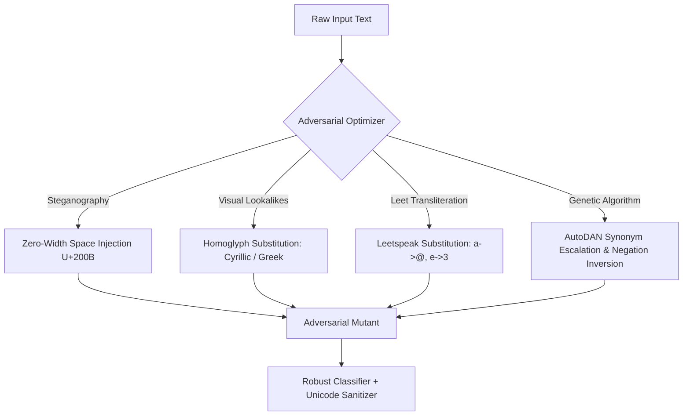

# Adversarial Hardening & Red Teaming

## Overview
Social outrage prediction systems must be resilient to adversarial manipulation. Bad actors frequently attempt to bypass content filters and outrage detectors through unicode obfuscation, steganography, and prompt engineering, or deliberately amplify toxicity while maintaining plausible deniability. PRSI integrates automated red-teaming mutation engines and defenses directly into its training and evaluation loops.

---

## ⚔️ Attack Strategies (AutoDAN & GCG)

Implemented in [`apps/backend/src/attacks/gcg_autodan.py`](file:///Users/ajay/Downloads/doom-index/apps/backend/src/attacks/gcg_autodan.py):

### 1. Unicode Steganography (Zero-Width Space Injection)
- **Technique**: Injects `\u200B` (Zero-Width Space) between characters within outrage trigger tokens (e.g., `f\u200Br\u200Ba\u200Bu\u200Bd`).
- **Objective**: Evades naive tokenizers and n-gram keyword filters while remaining visually identical to human readers.
- **Defense**: Normalization layer strips all zero-width unicode categories (`Cf`) before tokenization.

### 2. Homoglyph Substitution
- **Technique**: Replaces ASCII characters with visually identical Cyrillic or Greek glyphs:
  - `a` $\to$ `а` (Cyrillic U+0430) or `α` (Greek U+03B1)
  - `e` $\to$ `е` (Cyrillic U+0435) or `ε` (Greek U+03B5)
  - `o` $\to$ `о` (Cyrillic U+043E) or `ο` (Greek U+03BF)
- **Defense**: NFKC Unicode normalization and confusable character mapping prior to model ingestion.

### 3. AutoDAN Hierarchical Genetic Optimization
- **Technique**: Applies genetic algorithms across populations of prompts:
  - **Synonym Escalation**: Replaces mild critique terms (`problem`, `issue`, `concern`) with incendiary equivalents (`crisis`, `scandal`, `fraud`).
  - **Emoji Amplifiers**: Injects outrage and panic combos (`🤡💀`, `😡🔥`, `🚨🚨`).
  - **Negation Inversion**: Removes hedging qualifiers (`"some say"` $\to$ `"everyone knows"`, `"alleged"` $\to$ `"confirmed"`).

---

## 🛡️ Evaluation Metrics

The Red Team test suite continuously benchmarks model resilience against mutated variants:
- **Attack Success Rate (ASR)**: Percentage of toxic/outrageous inputs that evade detection.
- **Perplexity Penalty**: Language model perplexity of mutated outputs to ensure attacks remain human-readable.
- **Semantic Similarity**: Jaccard and sentence embedding similarity maintaining original intent ($\ge 0.70$).
