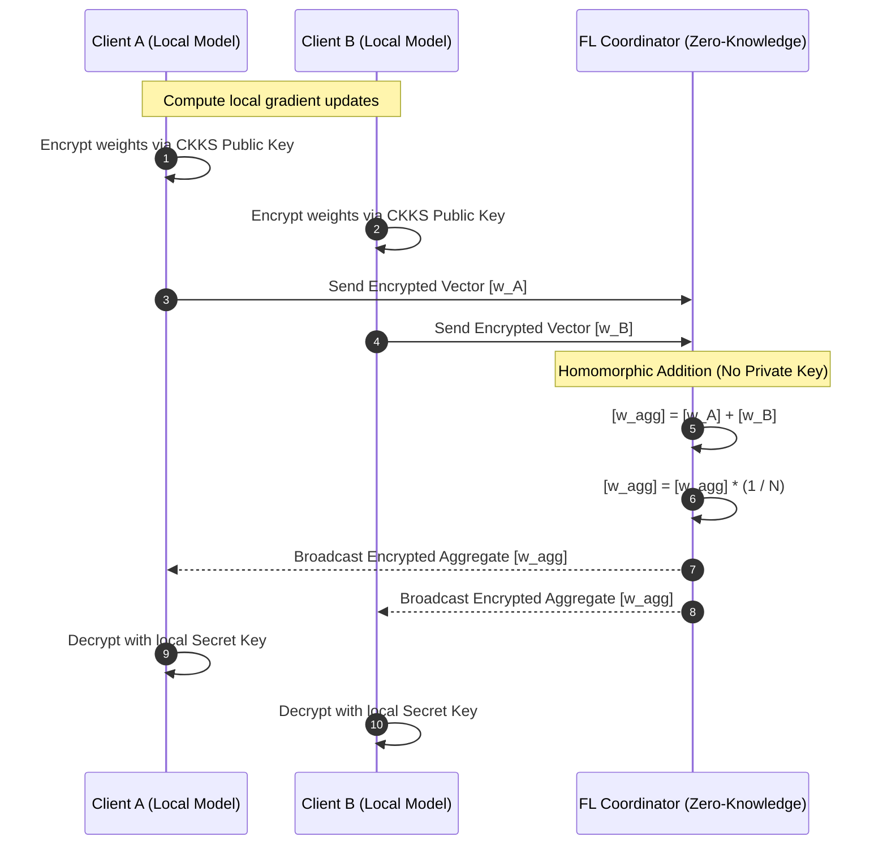

# Privacy & Federated Learning

## Overview
Because social data and risk scores involve sensitive communications and public figures, PRSI incorporates **Differential Privacy (DP)** during training and **Federated Learning with Homomorphic Encryption (SMPC/HE)** across distributed nodes.

---

## 🔒 Layer-Wise Adaptive DP-Adam

Implemented in [`apps/backend/src/privacy/dp_adam_adaptive.py`](file:///Users/ajay/Downloads/doom-index/apps/backend/src/privacy/dp_adam_adaptive.py):

### 1. The Differential Privacy Guarantee
The training loop enforces $(\varepsilon, \delta)$-Differential Privacy by clipping per-sample gradients and injecting calibrated Gaussian noise:

$$\mathbf{g}_i^{(l)} \leftarrow \mathbf{g}_i^{(l)} \cdot \min\left(1, \; \frac{C^{(l)}}{\|\mathbf{g}_i^{(l)}\|_2}\right)$$

$$\tilde{\mathbf{g}}^{(l)} = \frac{1}{B} \left( \sum_{i=1}^B \mathbf{g}_i^{(l)} + \mathcal{N}\left(0, \; \sigma^2 (C^{(l)})^2 \mathbf{I}\right) \right)$$

where $C^{(l)}$ is the layer-specific clipping threshold for layer $l$, and $\sigma$ is the noise multiplier calibrated via RDP (Rényi Differential Privacy) accounting.

### 2. Adaptive Quantile Clipping
Rather than using a fixed, manually tuned clipping threshold across all layers, DP-Adam adaptively tracks the empirical gradient norm distribution:
$$C_{t+1}^{(l)} = C_t^{(l)} \exp\left(-\eta_C (\hat{q}_t - \gamma)\right)$$
where $\gamma = 0.5$ targets the median gradient norm, ensuring gradients are not excessively truncated or swamped by noise.

---

## 🛡️ Homomorphic Federated Learning (TenSEAL CKKS)

Implemented in [`apps/backend/src/privacy/encrypted_fl.py`](file:///Users/ajay/Downloads/doom-index/apps/backend/src/privacy/encrypted_fl.py):

### 1. CKKS Scheme Parameters
- **Polynomial Modulus Degree:** 8192.
- **Coefficient Modulus Bit Sizes:** `[60, 40, 40, 60]`.
- **Global Scale:** $2^{40}$.
- **Coordinator Security:** The aggregation coordinator retains **only the public context**; it has zero access to the private decryption key and cannot inspect client weights in plaintext.

### 2. Cryptographic SecAgg Fallback
When TenSEAL native libraries are unavailable (e.g. in environments lacking AVX2 acceleration), the coordinator automatically falls back to **additive secret masking (SMPC)**:
$$\mathbf{y}_i = \mathbf{w}_i + \sum_{j > i} \mathbf{r}_{ij} - \sum_{j < i} \mathbf{r}_{ji}$$
The pairwise pseudo-random masks $\mathbf{r}_{ij}$ sum exactly to zero upon aggregation $\sum_i \mathbf{y}_i = \sum_i \mathbf{w}_i$, preserving client confidentiality.
